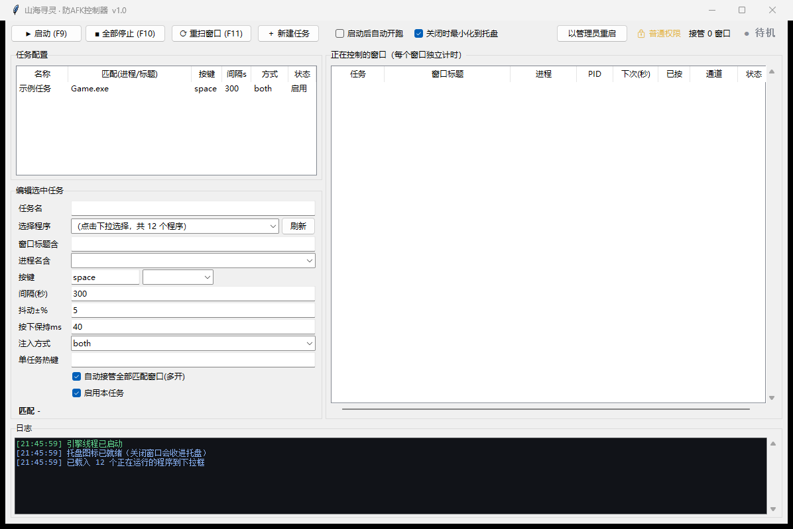
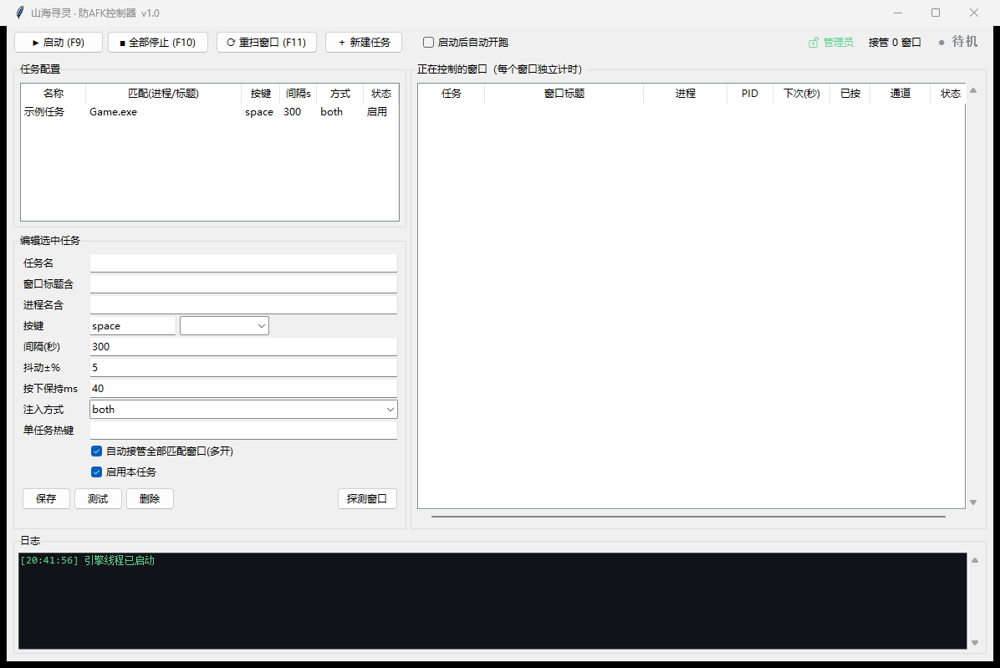

# 山海寻灵 · 防AFK控制器

> Windows 后台防 AFK 按键工具。**自定义间隔、自定义按键、最小化/后台运行、多应用多窗口同时控制**，零第三方依赖，双击即用。

[](https://github.com/Jiissoooo/shanhai-afk-guard)
[](https://www.python.org/downloads/windows/)
[](LICENSE)
[](requirements.txt)



---

## 这是什么

一个纯 Win32 的定时按键工具，用来给长期挂着的程序（页游、模拟器、客户端游戏、直播挂机）定期发一个键，避免因长时间无操作被踢下线或暂停。

和网上常见的"按键精灵脚本"的区别：

| | 普通按键脚本 | 本项目 |
|---|---|---|
| 注入方式 | 只 `SendInput`（必须前台） | `PostMessage` / `SendInput` / 闪切前台 / 混合，四选一 |
| 后台运行 | 做不到，游戏必须在前台 | **可以最小化，甚至可以完全被别的窗口盖住** |
| 多开 | 一个脚本一个窗口 | 同一进程 N 个窗口各自独立计时、自动错峰 |
| 权限 | 报"没反应"就没了 | **主动检测 UIPI 拦截**并标红告警，附 A/B 实测数据 |
| 窗口过滤 | 见到就点 | 排除 wegame 那类程序的十几个内部辅助窗 |
| 依赖 | 要装一堆库 | **零依赖**，Python 标准库 + 系统自带组件 |

---

## 快速开始

1. 装 [Python 3.10+](https://www.python.org/downloads/windows/)，安装时勾选 **Add python.exe to PATH**
2. 下载本仓库（`Code → Download ZIP` 解压，或 `git clone`）
3. **双击 `启动.bat`**，在 UAC 弹窗点「是」
4. 右上角出现 `🔓 管理员` 就是对的
5. 点「＋新建任务」→ 下拉框选你的程序 → 填按键和间隔 → 点「▶ 启动 (F9)」

> `启动.bat` 会自动检查权限、自动弹 UAC、自动定位 Python（会跳过微软商店那个 0 字节占位程序）。
> 找不到 Python 时会明确告诉你怎么办，不会闪退。

### 其它入口

| 文件 | 用途 |
|---|---|
| `启动.bat` | **推荐**。自动提权 + 自动找 Python，有控制台窗口便于看日志 |
| `启动.vbs` | 完全无黑框。用 `pythonw.exe` 拉起界面，适合长期挂 |
| `run_admin.bat` | 手动提权（依赖 PATH 里的 python） |
| `run.bat` | 不提权启动，仅用于测试普通权限目标 |
| `python main.py` | 自己保证是管理员的前提下直接跑 |

---

## 为什么必须用管理员启动（实测数据）

Windows 的 **UIPI（用户界面特权隔离）** 规定：低完整性级别（IL）的进程不能向高 IL 的进程发送窗口消息或 `SendInput`。`PostMessage` 会直接返回 `FALSE`，`GetLastError() == 5`（`ERROR_ACCESS_DENIED`）。

游戏平台（WeGame / TASLogin / 游戏本体）一般以管理员身份启动，因此是 **High 完整性**。

本机实测（Windows 11 + Python 3.12，Medium 权限 vs 管理员权限）：

| 目标进程 | 完整性 | 普通权限 | 管理员权限 |
|---|---|---|---|
| SpeedBall.exe | High | `FALSE` err=5 ❌ | `TRUE` err=0 ✅ |
| wegame.exe | High | `FALSE` err=5 ❌ | `TRUE` err=0 ✅ |
| tcls_core.exe | High | `FALSE` err=5 ❌ | `TRUE` err=0 ✅ |
| wegame_env.exe | High | `FALSE` err=5 ❌ | `TRUE` err=0 ✅ |
| SEGameTool.exe | High | `FALSE` err=5 ❌ | `TRUE` err=0 ✅ |
| explorer.exe | Medium | `TRUE` err=0 ✅ | `TRUE` err=0 ✅ |

**普通权限 0/5 → 管理员权限 5/5。**

自己验证：

```bat
python main.py --permissions    :: 列出本机所有需要管理员才能控制的目标
python tests\test_uipi.py       :: A/B 对照，打印 API 返回值与错误码
```

> **注意**：权限不足时，界面上的目标**仍会显示"在线"**——消息确实投递出去了，只是被 UIPI 在内核层拦下。
> 所以要看日志里的红色 `⚠ 权限不足`，别只看"在线"两个字。

---

## 界面与操作



### 三步上手

1. **＋新建任务** → 在「选择程序」下拉框里**直接选**正在运行的程序（无需手输进程名）
2. 设置 **按键**（默认 `space`）、**间隔(秒)**（最小 0.5）
3. 点 **▶ 启动 (F9)**

> 点「启动」时会自动应用表单里已填的内容，**不点保存也能跑**；但想让它记住，需要点一次「保存」。

### 完整流程（含删除）

| 步骤 | 操作 | 说明 |
|---|---|---|
| 1 | 点 **＋新建任务** | 左侧列表新增一行 |
| 2 | **在左侧列表点选这一行** | 必须先选中，右侧表单才会载入它 |
| 3 | 「选择程序」下拉框选目标 | 选中即自动填进程名 |
| 4 | 填「按键」「间隔(秒)」 | 间隔最小 0.5 秒 |
| 5 | 看底部 **「匹配 N 个窗口」** | **必须绿色且 N ≥ 1**，0 就先别启动 |
| 6 | 点 **保存** | 落盘到 `config/targets.json` |
| 7 | 点 **▶ 启动 (F9)** | 开始工作 |
| 8 | 关窗口 / 最小化 | 收进托盘，后台继续 |

**删除任务**：左侧点选那一行 → 点「删除」→ 确认框会显示这条任务的匹配规则 → 点「是」。
删除后该任务控制的窗口**立即脱管**，其它任务完全不受影响。

**临时停某个任务不删**：取消勾选「启用本任务」→ 保存。

### 程序下拉框

- 自动列出当前所有正在运行的程序，按窗口数排序，多开程序带 `[N个窗口]` 标记
- 选中后自动填好进程名；任务名为空时还会自动命名
- 支持**输入过滤**：敲 `game` 就只剩含 game 的项
- 每 5 秒自动刷新；也可点「刷新」立即更新
- 右边的「匹配 N 个窗口」实时显示这条规则会接管几个窗口，**看到 0 就先别启动**

**多开**：选一个多开程序（如 `[3个窗口] 山海寻灵`）后，程序会自动提取这些窗口标题的公共部分（如 `山海寻灵`）填入「窗口标题含」，把范围精确收窄到那 3 个窗口。

> 标题 + 进程名是 **AND** 关系（两个都填就必须同时满足），这样才能在 `python.exe`、模拟器这类宿主进程下精确锁定目标。

---

## 注入方式怎么选

| 方式 | 目标是否需在前台 | 能否最小化 | 适用 |
|---|---|---|---|
| `message` | **不需要** | **可以** | 模拟器（雷电/MuMu/蓝叠）、普通窗口程序 |
| `sendinput` | 需要（会自动闪切前台） | 可以，但会抢焦点 | 只认真实键盘的 DirectInput/RawInput 游戏 |
| `focus` | 自动闪切前台再闪回 | 可以 | 同上，每次约 120ms 抢焦点 |
| `both`（默认） | 不需要 | **可以** | 先用 message；目标恰好在前台时叠加 sendinput |

**怎么判断用哪个**：默认 `both` 跑两天，若游戏内 AFK 仍在掉，说明该游戏走 DirectInput 会丢弃 `PostMessage`，改用 `focus`。

`message` 模式会把按键投递到目标 GUI 线程的**焦点子窗口**（`GetGUIThreadInfo`）而不是顶层窗口——模拟器把输入收在子窗口里，直接对顶层 `PostMessage` 往往无效。

---

## 参数说明

| 参数 | 含义 |
|---|---|
| **选择程序** | 从下拉框选正在运行的程序，选中即自动填进程名，可输入过滤 |
| 窗口标题含 | 标题子串匹配，大小写不敏感。多开时自动填入公共前缀 |
| 进程名含 | 如 `Game.exe` 或 `Game`（可省略 `.exe`）。选程序后自动填 |
| 按键 | `space` `enter` `tab` `esc` `f1`~`f24` `a`~`z` `0`~`9` `numpad0`~`numpad9` `left` `up` 等，或 `0x20` 直接写 VK 码 |
| 间隔(秒) | 最小 0.5 秒 |
| 抖动±% | 每次间隔随机浮动，避免固定节拍。`5` 表示 300s ±15s |
| 按下保持ms | 一个按键从按下到抬起的时长，默认 40ms |
| 自动接管全部匹配窗口 | 关掉则只控制第一个命中的窗口 |
| 单任务热键 | 独立启用/暂停该任务 |

### 全局热键（游戏内也能按）

| 键 | 功能 |
|---|---|
| `F9` | 总开关（启动/暂停） |
| `F10` | 全部停止 |
| `F11` | 重扫窗口 |

热键由引擎线程用 `GetAsyncKeyState` 轮询，**游戏窗口有焦点时同样生效**。

---

## 收进托盘，后台继续跑

**点右上角 X 不会退出程序**，而是把窗口收进右下角托盘，引擎继续在后台工作（默认勾选「关闭时最小化到托盘」）。

**双击 / 左键单击托盘图标** → 恢复主窗口

**右键菜单**：

| 菜单项 | 功能 |
|---|---|
| 打开主窗口 | 恢复界面 |
| 启动 / 暂停 (F9) | 不切回窗口也能控制引擎 |
| 全部停止 (F10) | 立即停全部任务 |
| 当前接管 N 个窗口 | 状态显示（灰色只读） |
| 退出程序 | **真正退出** |

悬停显示 `山海寻灵 · 防AFK控制器 · 运行中 · 接管3窗口`。

**真退出只有两个途径**：① 托盘右键 →「退出程序」；② 取消勾选「关闭时最小化到托盘」后点 X 并在确认框点「是」。

> 托盘用 Windows 原生 `Shell_NotifyIcon`（[app/tray.py](app/tray.py)），不依赖 pystray 等第三方库。
> 图标为多尺寸 ico（16/32/48/64/128/256），托盘用 16px 版本。托盘消息循环跑在独立线程，不阻塞界面。

---

## 行为特征

- **每个窗口独立计时**：3 个客户端 = 3 条计时线，互不阻塞
- **自动错峰**：新接管窗口按 0.2s 递推错开，不会同一毫秒齐发
- **智能窗口过滤**：只接管真正的主窗口。`WECHAT_AUTH_MESSAGE_WIN` / `TCLS_CORE_WND` / `GDI+ Window` / `no_active_wnd` / `ClassName<数字>` 这类内部辅助窗全部排除
- **最小化仍生效**：过滤规则显式豁免最小化窗口（其客户区尺寸为 0x0，若按尺寸判断会被误杀）
- **自动重挂**：窗口关闭 → 20 秒宽限后丢弃；新窗口出现 → 3 秒内自动接管
- **连续失败脱管**：同一窗口连丢 5 次消息即停止尝试，日志标红，不会无限空打
- **权限预检**：接管时自动检查完整性级别，权限不足立刻标红告警
- **配置热保存**：存于 `config/targets.json`，原子写入（先写 `.tmp` 再 `os.replace`）

---

## 常见问题

**Q: 游戏里没反应，但界面显示"在线"？**
"在线"只代表消息投递成功。游戏用 DirectInput/RawInput 会丢弃 `PostMessage` → 把注入方式改成 `focus`。若日志有红色 `⚠ 权限不足`，先用管理员重启。

**Q: 全屏游戏无效？**
独占全屏下所有注入都受限。改成"无边框窗口"模式。

**Q: 显示"掉线"？**
窗口被关闭或连续 5 次投递失败。检查进程是否还在、是否被反作弊拦截。

**Q: 需要管理员权限吗？**
**需要。** 见上面 [为什么必须用管理员启动](#为什么必须用管理员启动实测数据)。

**Q: 能同时控制几个应用？**
不限。每个"任务"可对应不同的 exe，多任务并行；同一任务内的多开窗口也全部接管。

**Q: 端口占用 / 联网吗？**
不联网，不开端口，纯本地按键投递。零第三方依赖，零遥测。

---

## 验证测试

```bat
python tests\run_all.py
```

| 测试 | 验证内容 |
|---|---|
| `main.py --check` | VK 映射、窗口枚举、matcher、配置模型、注入、tick 全链路自检 |
| `test_config.py` | 配置往返、非法按键拒绝、空规则不误接管、野句柄容错、大小写匹配 |
| `test_multitarget.py` | 3 窗口（2 个最小化）+ 前台切走 → 每个都收到按键 |
| `test_multiopen.py` | 同进程多开独立计时、错峰、抖动生效 |
| `test_sendinput.py` | message / sendinput / 双通道降级 |
| `test_window_filter.py` | 窗口过滤：拒绝 wegame 辅助窗、最小化窗口不被误杀 |
| `test_app_picker.py` | 程序下拉框：填充、选中回填、输入过滤、新程序自动发现 |
| `test_task_crud.py` | 任务增删改：删除中间项后实例清理与索引对齐 |
| `test_run_flow.py` | 填完信息→启动全流程、启动时自动应用表单、停止、持久化 |
| `test_multiopen_pick.py` | 多开精确匹配：公共前缀提取 + AND 语义只命中目标 3 个 |
| `test_foreground.py` | 抢前台四种窗口初始状态均满成功率 |
| `test_tray.py` | 托盘：`Shell_NotifyIcon` 注册、tooltip、菜单命令分发、卸载 |
| `test_tray_e2e.py` | 点 X 收进托盘后引擎仍在投递按键、恢复、真退出 |
| `test_uipi.py` | UIPI 拦截 A/B 对照：Medium 通过 / High 被拒 err=5 |
| `test_admin_wegame.py` | 对 WeGame 等真实平台进程的投递实测 |
| `test_gui_e2e.py` | 真实 Tk 界面点击启动→投递→暂停全流程 |

---

## 文件结构

```
shanhai-afk-guard/
├── 启动.bat             ★ 双击这个（自动提权 + 自动找 Python）
├── 启动.vbs             无黑框启动（pythonw.exe）
├── run_admin.bat        手动提权启动
├── run.bat              不提权启动（测试用）
├── main.py              入口（--check 自检 / --admin 提权 / --permissions 权限诊断）
├── app/
│   ├── winapi.py        窗口枚举 / 进程名 / VK映射 / 焦点子窗口 / 窗口过滤
│   ├── inject.py        PostMessage / SendInput / 闪切前台
│   ├── integrity.py     完整性级别检测 + UIPI 预判
│   ├── elevate.py       UAC 提权与权限状态
│   ├── tray.py          系统托盘（原生 Shell_NotifyIcon）
│   ├── engine.py        调度核心（多实例独立计时 + 权限预检告警）
│   └── ui.py            tkinter 界面
├── assets/tray.ico      托盘图标（多尺寸）
├── config/
│   ├── targets.example.json  配置模板（复制成 targets.json 用）
│   └── targets.json          运行时生成，已被 .gitignore 忽略
├── launcher/            原生 C# 启动器源码（可选，见下）
├── scripts/
│   ├── find_python.bat  解释器查找（排除商店占位程序）
│   ├── build.bat        PyInstaller 打包
│   ├── upload_repo.py   发布到 GitHub（curl 客户端 + 重试）
│   └── app.manifest     UAC manifest（highestAvailable）
├── docs/详细手册.md      完整版使用手册（含所有细节与实测记录）
├── tests/               16 组自动化验证
└── requirements.txt     仅打包时需要，运行不需要
```

---

## 打包成独立 exe（可选）

```bat
pip install pyinstaller
scripts\build.bat
```

产物 `dist\山海寻灵防AFK.exe`，manifest 已声明 `highestAvailable`，双击即自动请求管理员权限。

另外 [launcher/Launcher.cs](launcher/Launcher.cs) 是一个更轻量的 C# 启动器（约 6 KB），用系统自带的 `csc` 编译，不需要联网也不需要 PyInstaller：

```bat
csc /target:winexe /win32manifest:launcher.manifest /out:山海寻灵防AFK.exe Launcher.cs
```

它只做三件事：隐藏控制台、自动定位 `pythonw.exe`、用 manifest 声明 `requireAdministrator`。

> **注意**：若系统开启了「智能应用控制 (Smart App Control)」，所有无信誉签名的新编译 exe 都会被拦截（实测连 hello-world 都拦）。这种情况直接用 `启动.vbs` —— 它走 `wscript.exe` + 已有 Python，不受该策略影响。

---

## 免责声明

本项目是一个通用的 Windows 键盘消息投递工具，用于自动化你**有权操作**的本地程序。

- 仅供学习 Win32 窗口消息、UIPI、输入注入等知识，以及个人自用
- 请遵守你所使用程序/游戏的服务条款。**因使用本工具导致的封号、数据损失等后果由使用者自行承担**
- 本项目不包含任何反检测、反作弊绕过、内存读写、进程注入（DLL injection）功能，也**不应**被用于此类用途
- 作者不对任何滥用行为负责

如果你是游戏厂商并认为本项目侵犯了你的权益，请提 issue 联系。

---

## License

[MIT](LICENSE)
